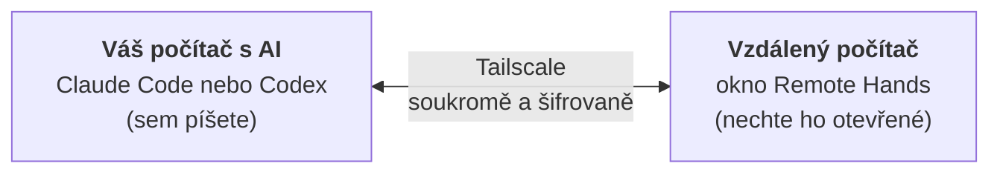

<div align="center">

# Remote Hands

[English](README.md) · [中文](README.zh-CN.md) · **Čeština**

**Nechte Claude Code nebo Codex na jednom svém počítači pracovat na jiném svém počítači – soukromě, přes Tailscale.**

[](https://github.com/HamsterPark/remote-hands/actions/workflows/ci.yml)
[](https://github.com/HamsterPark/remote-hands/releases/latest)
[](LICENSE)

</div>

Na jednom počítači používáte AI asistenta (umělou inteligenci) – **Claude Code** nebo **Codex**. Díky Remote Hands může
tento asistent pracovat i na vašem **druhém** počítači: prohlížet soubory, instalovat programy, opravovat nastavení
nebo pořídit snímek obrazovky – jako by u něj seděl. Stačí jednou zkopírovat **dva řádky**.



> **Spěcháte a rozumíte počítačům?** Nainstalujte [Tailscale](https://tailscale.com/download) na oba počítače pod
> stejným účtem. Na vzdáleném počítači spusťte
> `$env:REMOTE_HANDS_LANG='cs'; irm https://raw.githubusercontent.com/HamsterPark/remote-hands/main/install.ps1 | iex`
> (Windows PowerShell) nebo
> `curl -fsSL https://raw.githubusercontent.com/HamsterPark/remote-hands/main/install.sh | REMOTE_HANDS_LANG=cs sh`
> (macOS, Linux), oba vypsané řádky vložte do programu Claude Code nebo Codex na druhém počítači a AI restartujte.
> Podrobnosti: [technické poznámky](docs/TECHNICAL.md) (anglicky).

## Obsah

1. [Než začnete](#než-začnete)
2. [Krok 1 – Nainstalujte Tailscale na oba počítače](#krok-1--nainstalujte-tailscale-na-oba-počítače)
3. [Krok 2 – Přihlaste se k Tailscale pod stejným účtem](#krok-2--přihlaste-se-k-tailscale-pod-stejným-účtem)
4. [Krok 3 – Spusťte Remote Hands na vzdáleném počítači](#krok-3--spusťte-remote-hands-na-vzdáleném-počítači)
5. [Krok 4 – Pošlete oba řádky na počítač s AI](#krok-4--pošlete-oba-řádky-na-počítač-s-ai)
6. [Krok 5 – Předejte oba řádky programu Claude Code nebo Codex](#krok-5--předejte-oba-řádky-programu-claude-code-nebo-codex)
7. [Každodenní používání](#každodenní-používání)
8. [Bezpečnost – přečtěte si to](#bezpečnost--přečtěte-si-to)
9. [Problémy a řešení](#problémy-a-řešení)

## Než začnete

V tomto návodu se používají dvě slova:

* **Počítač s AI** – počítač, na kterém používáte Claude Code nebo Codex. Sem píšete svá přání.
* **Vzdálený počítač** – počítač, na kterém má AI pracovat. Běží na něm Remote Hands.

Budete potřebovat:

* Dva počítače s **Windows 10 nebo 11**, **macOS 13 či novějším** nebo s **Linuxem**, oba připojené k internetu.
  Mohou být v různých domech nebo zemích.
* Na počítači s AI musí už fungovat **Claude Code**
  ([jak ho nainstalovat](https://code.claude.com/docs/en/overview)) nebo **Codex**
  ([jak ho nainstalovat](https://developers.openai.com/codex)).
* **Účet Google, Microsoft, Apple nebo GitHub**, kterým se přihlásíte k Tailscale. Tailscale je pro osobní použití
  zdarma.
* Asi **15 minut**.

> [!TIP]
> Postupujte popořadě. Každý krok říká, na **kterém** počítači ho máte provést.

## Krok 1 – Nainstalujte Tailscale na oba počítače

[Tailscale](https://tailscale.com) je bezplatná aplikace, která propojí vaše vlastní počítače do malé soukromé sítě,
ať jsou kdekoli. Remote Hands komunikuje jen přes tuto soukromou síť, takže se k němu nikdo z internetu nedostane.

**Tento krok proveďte na vzdáleném počítači *i* na počítači s AI.** Pokud už Tailscale máte nainstalovaný, přeskočte
na Krok 2.

### Windows

1. Otevřete ve webovém prohlížeči <https://tailscale.com/download/windows>.
2. Klikněte na **Download Tailscale for Windows** (stáhnout Tailscale pro Windows).
3. Až se stahování dokončí, otevřete stažený soubor (jmenuje se asi `tailscale-setup-….exe` a je ve složce
   **Stažené soubory**).
4. Windows se zeptá *„Chcete této aplikaci povolit, aby prováděla na vašem zařízení změny?“* (anglicky *Do you want to
   allow this app to make changes to your device?*) – klikněte na **Ano** (*Yes*).
5. Projděte instalaci až do konce: pokud se zeptá, přijměte licenci a klikněte na **Install** (instalovat).
6. Tailscale pak najdete jako malou ikonu **vpravo dole na obrazovce, vedle hodin**. Pokud ji nevidíte, klikněte tam
   na malou šipku **^** (*Zobrazit skryté ikony*) – ikona může být schovaná v tomto okénku.

### Mac

1. Otevřete ve webovém prohlížeči <https://tailscale.com/download/mac>.
2. Klikněte na **Download Tailscale for macOS**. Použijte toto stažení, ne App Store
   (v pevninské Číně App Store Tailscale vůbec nenabízí).
3. Otevřete stažený soubor (`Tailscale-….pkg`, ve složce **Stahování**) a klikněte na **Pokračovat** a **Instalovat**.
   Když se Mac zeptá, zadejte své heslo k Macu.
4. Otevřete **Tailscale** ze složky **Aplikace**.
5. Mac zobrazí upozornění **System Extension Blocked** (systémové rozšíření bylo zablokováno). Klikněte na tlačítko
   **Open System Settings** (otevřít Nastavení systému) a potom:
   * **macOS 15 nebo novější:** otevřete **Obecné → Aktivace položek a rozšíření při přihlášení**
     (*Login Items & Extensions*), klikněte na **ⓘ** vedle **Síťová rozšíření** (*Network Extensions*),
     zapněte **Tailscale Network Extension**, zadejte heslo a klikněte na **Hotovo**.
   * **macOS 13 nebo 14:** otevřete **Soukromí a zabezpečení** (*Privacy & Security*), sjeďte dolů k hlášení
     *„System software from application Tailscale.app was blocked from loading“* (systémový software z aplikace
     Tailscale.app byl zablokován) a klikněte na **Povolit** (*Allow*).
6. Pokud se Mac zeptá, jestli může přidat konfiguraci VPN, klikněte na **Povolit**.
7. Tailscale pak najdete jako malou ikonu v **řádku nabídek vpravo nahoře na obrazovce**.

### Linux

Otevřete terminál (často <kbd>Ctrl</kbd>+<kbd>Alt</kbd>+<kbd>T</kbd>) a spusťte:

```sh
curl -fsSL https://tailscale.com/install.sh | sh
sudo tailscale up
```

Druhý příkaz vypíše webový odkaz. Otevřete ho a pokračujte Krokem 2, bodem 2.

## Krok 2 – Přihlaste se k Tailscale pod stejným účtem

**Tento krok proveďte na obou počítačích.**

1. Klikněte na **ikonu Tailscale** (Windows: vpravo dole vedle hodin; Mac: vpravo nahoře v řádku nabídek) a vyberte
   **Log in…** (přihlásit se). Při prvním spuštění se místo toho může zobrazit uvítací okno s tlačítkem
   **Get Started** (začít) – klikněte na něj.
2. Ve webovém prohlížeči se otevře stránka Tailscale. Vyberte způsob přihlášení: **Sign in with Google** (přihlásit
   se přes Google), **Microsoft**, **GitHub** nebo **Apple**, a přihlaste se jako obvykle.
3. Při prvním přihlášení se Tailscale může zeptat na pár věcí (například **Personal use** – osobní použití, nebo
   **Business use** – firemní použití; vyberte **Personal use**) a může po vás chtít, abyste zařízení připojili
   (**Connect**). Klikněte na **Connect** (připojit).

> [!IMPORTANT]
> **Na obou počítačích použijte úplně stejný účet** (stejného poskytovatele, stejný e-mail). Při dvou různých účtech
> vzniknou dvě oddělené soukromé sítě a počítače se navzájem neuvidí.

**Ověřte, že to funguje:** klikněte znovu na ikonu Tailscale. Měli byste vidět jméno svého počítače a číslo, které
začíná na **100.** – a pod položkou **Network devices** (síťová zařízení) ten druhý počítač. Můžete také otevřít
<https://login.tailscale.com/admin/machines>: musí tam být uvedeny oba počítače.

> [!TIP]
> Tailscale po 180 dnech požádá každý počítač o nové přihlášení. Aby vzdálený počítač fungoval i bez vás, otevřete
> seznam počítačů na odkazu výše, u vzdáleného počítače klikněte na **…** a vyberte **Disable key expiry** (vypnout
> vypršení platnosti klíče).

## Krok 3 – Spusťte Remote Hands na vzdáleném počítači

**Tento krok proveďte na vzdáleném počítači.**

### Windows

1. Klikněte na tlačítko **Start** (logo Windows), napište **PowerShell** a stiskněte <kbd>Enter</kbd>.
   Otevře se okno s textovým řádkem. (Nevybírejte **Spustit jako správce** (*Run as administrator*) – není to
   potřeba.)
2. Zkopírujte tento řádek (na GitHubu se tlačítko pro kopírování objeví na pravém konci rámečku, když na něj
   najedete myší):

   ```powershell
   $env:REMOTE_HANDS_LANG='cs'; irm https://raw.githubusercontent.com/HamsterPark/remote-hands/main/install.ps1 | iex
   ```

3. Klikněte do okna PowerShellu, vložte řádek pomocí <kbd>Ctrl</kbd>+<kbd>V</kbd> (nebo pravým tlačítkem myši)
   a stiskněte <kbd>Enter</kbd>.
4. Za pár sekund se objeví obrazovka Remote Hands (viz příklad níže).
5. Pokud Windows zobrazí okno **Výstraha Zabezpečení Windows** s textem *„Firewall v programu Windows Defender
   zablokoval některé funkce této aplikace.“* (anglicky *Windows Defender Firewall has blocked some features of this
   app*), nechte zaškrtnuté **Privátní sítě** (*Private networks*) a klikněte na **Povolit přístup** (*Allow
   access*). (Je to potřeba, aby se mohl připojit počítač s AI.) Na nejnovějších Windows 11 může okno vypadat
   jinak – s názvem **Zabezpečení Windows**, otázkou *„Chcete privátním sítím povolit přístup k této aplikaci?“*
   a tlačítkem **Povolit**. Klikněte na **Povolit**.

### Mac

1. Stiskněte <kbd>⌘ Command</kbd>+<kbd>Space</kbd> (mezerník), napište **Terminál** a stiskněte <kbd>Enter</kbd>.
2. Zkopírujte tento řádek, vložte ho do okna Terminálu pomocí <kbd>⌘ Command</kbd>+<kbd>V</kbd> a stiskněte
   <kbd>Enter</kbd>:

   ```sh
   curl -fsSL https://raw.githubusercontent.com/HamsterPark/remote-hands/main/install.sh | REMOTE_HANDS_LANG=cs sh
   ```

3. Pokud se Mac zeptá, jestli smí Terminál přistupovat k souborům ve složce **Plocha**, klikněte na **OK** –
   Remote Hands tam ukládá svou spouštěcí ikonu.

### Linux

Otevřete terminál a spusťte stejný řádek jako na Macu.

### Co uvidíte

```text
==================================================================
  Remote Hands 0.1.0
  Umožňuje programu Claude Code nebo Codex na vašem druhém počítači
  ovládat TENTO počítač přes vaši soukromou síť Tailscale.
==================================================================

[OK] Tailscale je připojený. Tento počítač se jmenuje office-pc (100.86.1.2).
[OK] Čekám na vaši AI na adrese 100.86.1.2:47863 (přístup jen přes Tailscale).

ZKOPÍRUJTE 2 ŘÁDKY NÍŽE a vložte je do programu Claude Code nebo Codex na svém DRUHÉM počítači:
==================================================================
Remote Hands: please connect to my computer office-pc. It is an MCP server (streamable HTTP; the key is inside the URL, no other login): http://100.86.1.2:47863/mcp/0f3c9a2b7d4e8f1a6b5c3d2e9f0a1b7c
How: Claude Code -> claude mcp add -s user -t http office-pc <URL> (if office-pc already exists, first: claude mcp remove -s user office-pc) ; Codex -> codex mcp add office-pc --url <URL> ; then tell me to restart you, and use the office-pc tools (start with system_info).
==================================================================
(Už jsou zkopírované do schránky tohoto počítače. Na druhý počítač je dostanete tak, že si je pošlete e-mailem nebo přes chatovací aplikaci.)

 * Nechte toto okno otevřené. Když ho zavřete, vzdálené ovládání skončí.
 * Dokud je toto okno otevřené, tento počítač neusne.
 * Kdokoli, kdo má tyto 2 řádky a je ve vaší síti Tailscale, může tento počítač plně ovládat. Nikomu je nedávejte.
 * Aby staré 2 řádky přestaly fungovat, napište  new  a stiskněte Enter.

Co AI na tomto počítači dělá:
14:02:11  my-laptop  připojení (claude-code 2.1.310)
14:02:15  my-laptop  zjištění informací o systému
14:02:20  my-laptop  spuštění příkazu: Get-PSDrive C
```

Jméno vašeho počítače, adresa i klíč budou jiné. Dva řádky, které začínají `Remote Hands:` a `How:`, jsou schválně
anglicky – čte je AI, ne vy.

Okno mluví česky díky `cs` v řádku, který jste spustili (`$env:REMOTE_HANDS_LANG='cs'; ` na začátku ve Windows,
`REMOTE_HANDS_LANG=cs` před `sh` na Macu a v Linuxu). Bez této části by mluvilo jazykem vašeho počítače (anglicky,
čínsky nebo česky). Chcete-li jiný jazyk, změňte `cs` na `en` (angličtina) nebo `zh` (čínština).

> [!NOTE]
> **Příště** už tento řádek nepotřebujete: dvakrát klikněte na **Remote Hands** na ploše (ve Windows je i v nabídce
> Start). Dva řádky zůstanou stejné, takže počítač s AI není potřeba znovu nastavovat.

## Krok 4 – Pošlete oba řádky na počítač s AI

Oba řádky jsou už zkopírované (na vzdáleném počítači). Teď se musí dostat na počítač s AI. Vložte je
(<kbd>Ctrl</kbd>+<kbd>V</kbd>, na Macu <kbd>⌘</kbd>+<kbd>V</kbd>) někam, kde je na tamním počítači otevřete, například:

* do **e-mailu sobě** (třeba přes Seznam nebo Gmail),
* do chatovací aplikace, která umí **napsat zprávu sobě**: WhatsApp (**Napište zprávu sobě**, anglicky *Message
  yourself*), Telegram (**Uložené zprávy**, *Saved Messages*), Messenger (konverzace se sebou samým – najdete ji
  vyhledáním svého vlastního jména), Signal (**Poznámka pro sebe**, *Note to Self*), …
* mezi dvěma zařízeními Apple se stejným účtem Apple stačí vložit na druhém Macu (*Univerzální schránka*).

Na počítači s AI tu zprávu otevřete a oba řádky zkopírujte.

> [!WARNING]
> Oba řádky jsou klíč ke vzdálenému počítači. Posílejte je jen sami sobě.

## Krok 5 – Předejte oba řádky programu Claude Code nebo Codex

**Tento krok proveďte na počítači s AI.**

1. Spusťte Claude Code nebo Codex, jak jste zvyklí.
2. Vložte oba řádky do jeho chatovacího pole a stiskněte <kbd>Enter</kbd>.
3. AI chce spustit jeden příkaz, který uloží připojení (začíná `claude mcp add` nebo `codex mcp add`).
   Požádá vás o svolení – vyberte **Yes** (ano).
4. **Restartujte AI**, aby načetla nové připojení:
   * **Claude Code:** napište `/exit` a stiskněte <kbd>Enter</kbd>, potom napište `claude --continue` a stiskněte
     <kbd>Enter</kbd> (tím se také vrátí vaše konverzace).
   * **Codex:** napište `/exit` a stiskněte <kbd>Enter</kbd>, potom napište `codex resume --last` a stiskněte
     <kbd>Enter</kbd>.
   * V aplikaci (aplikace Claude pro počítač, VS Code, aplikace Codex): úplně ji zavřete a znovu otevřete.
5. Vyzkoušejte to: napište *„Použijte nástroj system_info na office-pc. Který je to počítač?“* (místo `office-pc`
   použijte jméno svého počítače z oněch dvou řádků).
6. Když AI poprvé použije nástroj Remote Hands, požádá o svolení. Přečtěte si, co chce udělat, a povolte to.

Hotovo! V okně Remote Hands na vzdáleném počítači můžete sledovat všechno, co AI dělá.

## Každodenní používání

Stačí AI říct, co chcete, a uvést jméno počítače:

* *„Kolik zbývá na office-pc volného místa na disku?“*
* *„Udělejte snímek obrazovky office-pc a řekněte mi, co píše chybové hlášení.“*
* *„Nainstalujte na office-pc program VLC a dejte mi zástupce na plochu.“*
* *„Najděte na office-pc fotky z minulého léta a zkopírujte je do nové složky na ploše.“*
* *„Zkontrolujte na babicka-notebook, jestli nečekají aktualizace Windows.“*

**Více počítačů:**

* **Mnoho vzdálených počítačů, jeden počítač s AI:** spusťte Remote Hands na každém vzdáleném počítači a dva řádky
  od každého z nich předejte AI. Každý počítač má své jméno; řekněte AI, který z nich má použít.
* **Jeden vzdálený počítač, více počítačů s AI:** vložte stejné dva řádky do programu Claude Code nebo Codex na
  každém počítači s AI.

**Zastavení a spuštění:**

* **Zastavení:** zavřete okno Remote Hands. Od té chvíle už AI na tom počítači nemůže nic dělat.
* **Opětovné spuštění:** dvakrát klikněte na **Remote Hands** na ploše. Stejné dva řádky, nic dalšího nenastavujete.
* Dokud je okno otevřené, vzdálený počítač neusne. (Notebook ale usne, když zavřete víko.)
* **Aktualizace:** spusťte znovu řádek z Kroku 3.

## Bezpečnost – přečtěte si to

* Remote Hands dává AI **stejnou moc nad vzdáleným počítačem, jakou máte vy**, když u něj sedíte: může číst, měnit
  a mazat vaše soubory a instalovat programy.
* Dostat se k němu mohou jen počítače ve **vaší vlastní** síti Tailscale, a to jen s tajným klíčem, který je v oněch
  dvou řádcích. Nic není otevřené do internetu a Tailscale vše šifruje.
* **Oba řádky nikomu nedávejte.** Pokud je může mít někdo další, napište v okně Remote Hands `new` a stiskněte
  <kbd>Enter</kbd>: staré řádky okamžitě přestanou fungovat. Nové řádky předejte své AI.
* Claude Code i Codex se před použitím nástroje ptají. **Přečtěte si, co chtějí udělat,** než to povolíte.
* AI nikdy nezíská práva správce sama. Pokud něco vyžaduje práva správce, objeví se na obrazovce vzdáleného počítače
  otázka a musí na ni odpovědět někdo, kdo u něj je.
* Okno zavřete, když ho nepotřebujete.

## Problémy a řešení

<details>
<summary><b>Okno píše, že čeká na Tailscale</b></summary>

Tailscale není na tomto počítači nainstalovaný, neběží nebo není přihlášený. Otevřete Tailscale a přihlaste se
(Kroky 1 a 2). Okno pak pokračuje samo.
</details>

<details>
<summary><b>AI hlásí, že se nemůže připojit (timeout, connection refused, failed)</b></summary>

Zkontrolujte postupně:

1. Je **okno Remote Hands na vzdáleném počítači pořád otevřené**?
2. Je vzdálený počítač **zapnutý a neusnul**? (Není v režimu spánku, víko notebooku je otevřené.)
3. Je Tailscale **připojený na obou počítačích pod stejným účtem**? Klikněte na ikonu Tailscale na každém z nich.
4. **Firewall ve Windows:** pokud jste při dotazu Windows na firewall klikli na **Zrušit**, Windows teď Remote Hands
   blokuje. Stiskněte <kbd>Windows</kbd>+<kbd>R</kbd>, napište `wf.msc` a stiskněte <kbd>Enter</kbd>. V okně, které
   se otevře (**Firewall v programu Windows Defender s pokročilým zabezpečením**, anglicky *Windows Defender Firewall
   with Advanced Security*), klikněte na **Příchozí pravidla** (*Inbound Rules*), najděte pravidla s názvem
   **remote-hands.exe** s červenou značkou, odstraňte je (pravé tlačítko myši → **Odstranit**), spusťte Remote Hands
   znovu a tentokrát klikněte na **Povolit přístup**.
5. Požádejte AI, aby spustila `curl http://<the 100.x.y.z address>:47863/health` (místo `<the 100.x.y.z address>`
   dosadí AI adresu vzdáleného počítače, která začíná číslem 100.). Pokud odpoví `remote-hands ok`, spojení funguje
   a problém je v nastavení AI: požádejte ji, aby ho zkontrolovala příkazem `claude mcp list` nebo `codex mcp list`.
</details>

<details>
<summary><b>AI hlásí „wrong key“ (špatný klíč) nebo „404 / not found“ (nenalezeno)</b></summary>

Někdo napsal do okna Remote Hands `new`, takže staré řádky už nefungují. Zkopírujte z okna nové dva řádky
a předejte je AI (Kroky 4 a 5) – nahradí původní připojení.
</details>

<details>
<summary><b>Ztratily se mi oba řádky</b></summary>

Podívejte se do okna Remote Hands, nebo Remote Hands spusťte znovu – vždy ukáže aktuální dva řádky (změní se jen
tehdy, když někdo napíše `new`).
</details>

<details>
<summary><b>Windows hlásí „Systém Windows ochránil váš počítač“, nebo si stěžuje antivirus</b></summary>

To se může stát, protože Remote Hands je nový program, který umožňuje vzdálené ovládání. Je open source a instalátor
kontroluje, že stažený soubor je přesně ten zveřejněný. Pokud mu důvěřujete, klikněte na **Další informace**
(u některých verzí Windows **Více informací**; anglicky *More info*) → **Přesto spustit** (*Run anyway*), nebo ho
povolte ve svém antivirovém programu.
</details>

<details>
<summary><b>Mac: snímky obrazovky ukazují jen pozadí plochy</b></summary>

Otevřete **Nastavení systému → Soukromí a zabezpečení → Záznam obrazovky a systémového zvuku** (*Screen & System
Audio Recording*; v macOS 13: **Záznam obrazovky**) a zapněte **Terminál**. Potom zavřete Remote Hands a spusťte ho
znovu.
</details>

<details>
<summary><b>Stahování z GitHubu nefunguje (například v pevninské Číně)</b></summary>

Zkuste to později nebo přes VPN. Ve Windows můžete program také stáhnout ručně ze
[stránky s vydanými verzemi (Releases)](https://github.com/HamsterPark/remote-hands/releases/latest) –
`remote-hands-windows-amd64.exe` (nebo `remote-hands-windows-arm64.exe` u vzácných počítačů s Windows a procesorem
ARM) – a dvakrát na něj kliknout. Na Macu nebo v Linuxu je nejjednodušší řádek do Terminálu; pokud je GitHub
blokovaný, použijte ho s VPN.
</details>

<details>
<summary><b>Jak Remote Hands odstraním?</b></summary>

* **Windows:** smažte zástupce **Remote Hands** a složky `%LOCALAPPDATA%\Programs\RemoteHands` a
  `%APPDATA%\remote-hands` (tyto názvy vložte do adresního řádku Průzkumníka souborů).
* **Mac:** smažte `Remote Hands.command` na ploše a v Terminálu spusťte
  `rm -rf ~/.local/bin/remote-hands ~/Library/Application\ Support/remote-hands`.
* **Linux:** `rm -rf ~/.local/bin/remote-hands ~/.config/remote-hands`
* **Na počítači s AI:** požádejte AI, aby připojení odstranila, nebo spusťte `claude mcp remove -s user office-pc`
  nebo `codex mcp remove office-pc`.
</details>

## Pro technicky zdatné

Jak to funguje, jaké nástroje AI dostane, bezpečnostní model, volby a sestavení ze zdrojového kódu:
**[docs/TECHNICAL.md](docs/TECHNICAL.md)** (anglicky).

Remote Hands je jeden malý program v jazyce Go bez závislostí. Protokol
[Model Context Protocol](https://modelcontextprotocol.io) nabízí jen na adrese počítače v síti Tailscale.
Příspěvky jsou vítány. Licence: [MIT](LICENSE).

*Remote Hands je nezávislý projekt a nemá žádnou vazbu na společnosti Tailscale, Anthropic ani OpenAI.*
