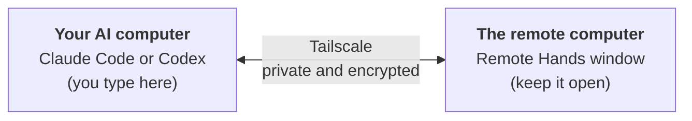

<div align="center">

# Remote Hands

**Let Claude Code or Codex on one of your computers work on another one of your computers – privately, through Tailscale.**

**English** · [中文](README.zh-CN.md) · [Čeština](README.cs.md)

[](https://github.com/HamsterPark/remote-hands/actions/workflows/ci.yml)
[](https://github.com/HamsterPark/remote-hands/releases/latest)
[](LICENSE)

</div>

You use an AI assistant – **Claude Code** or **Codex** – on one computer. Remote Hands lets that assistant also work
on your **other** computer: look at files, install programs, fix settings, take a screenshot of the screen – as if it
were sitting in front of it. You only need to copy **two lines** once.



> **In a hurry and know computers well?** Install [Tailscale](https://tailscale.com/download) on both computers
> with the same account. On the remote computer run
> `irm https://raw.githubusercontent.com/HamsterPark/remote-hands/main/install.ps1 | iex` (Windows PowerShell) or
> `curl -fsSL https://raw.githubusercontent.com/HamsterPark/remote-hands/main/install.sh | sh` (macOS, Linux),
> paste the two printed lines into Claude Code or Codex on the other computer, and restart the AI.
> Details: [technical notes](docs/TECHNICAL.md).

## Contents

1. [Before you start](#before-you-start)
2. [Step 1 – Install Tailscale on both computers](#step-1--install-tailscale-on-both-computers)
3. [Step 2 – Log in to Tailscale with the same account](#step-2--log-in-to-tailscale-with-the-same-account)
4. [Step 3 – Start Remote Hands on the remote computer](#step-3--start-remote-hands-on-the-remote-computer)
5. [Step 4 – Send the two lines to your AI computer](#step-4--send-the-two-lines-to-your-ai-computer)
6. [Step 5 – Give the two lines to Claude Code or Codex](#step-5--give-the-two-lines-to-claude-code-or-codex)
7. [Everyday use](#everyday-use)
8. [Safety – please read](#safety--please-read)
9. [Problems and solutions](#problems-and-solutions)

## Before you start

Two words are used in this guide:

* **AI computer** – the computer where you use Claude Code or Codex. You type your wishes here.
* **Remote computer** – the computer the AI should work on. Remote Hands runs here.

You need:

* Two computers with **Windows 10 or 11**, **macOS 13 or newer**, or **Linux**, both connected to the internet.
  They can be in different houses or countries.
* **Claude Code** ([how to install](https://docs.claude.com/en/docs/claude-code/overview)) or **Codex**
  ([how to install](https://developers.openai.com/codex)) already working on the AI computer.
* A **Google, Microsoft, Apple or GitHub account** to log in to Tailscale. Tailscale is free for personal use.
* About **15 minutes**.

> [!TIP]
> Do the steps in order. Every step says on **which** computer to do it.

## Step 1 – Install Tailscale on both computers

[Tailscale](https://tailscale.com) is a free app that connects your own computers into a small private network,
wherever they are. Remote Hands only talks through this private network, so nobody on the internet can reach it.

**Do this step on the remote computer *and* on the AI computer.** If Tailscale is already installed, skip to
Step 2.

### Windows

1. Open <https://tailscale.com/download/windows> in your web browser.
2. Click **Download Tailscale for Windows**.
3. When the download has finished, open the file (it is called something like `tailscale-setup-….exe` and is in
   your **Downloads** folder).
4. Windows asks *"Do you want to allow this app to make changes to your device?"* – click **Yes**.
5. Follow the installer: click **Install** and at the end **Close**.
6. Tailscale now lives as a small icon at the **bottom right of the screen, next to the clock**. If you cannot see
   it, click the small arrow **^** there – it may be hidden in that box.

### Mac

1. Open <https://tailscale.com/download/mac> in your web browser.
2. Click **Download Tailscale for macOS**. Use this download, not the App Store
   (in mainland China the App Store does not offer Tailscale at all).
3. Open the downloaded file (`Tailscale-….pkg`, in **Downloads**) and click **Continue** and **Install**. Type your Mac
   password when asked.
4. Open **Tailscale** from your **Applications** folder.
5. The Mac says *"System Extension Blocked"*. Click **Open System Settings**, then:
   * **macOS 15 or newer:** go to **General → Login Items & Extensions**, click the **ⓘ** next to
     **Network Extensions**, switch on **Tailscale Network Extension**, type your password, click **Done**.
   * **macOS 13 or 14:** go to **Privacy & Security**, scroll down to *"System software from application
     Tailscale.app was blocked from loading"* and click **Allow**.
6. If the Mac asks to add a VPN configuration, click **Allow**.
7. Tailscale now lives as a small icon in the **menu bar at the top right of the screen**.

### Linux

Open a terminal (often <kbd>Ctrl</kbd>+<kbd>Alt</kbd>+<kbd>T</kbd>) and run:

```sh
curl -fsSL https://tailscale.com/install.sh | sh
sudo tailscale up
```

The second command prints a web link. Open it and continue with Step 2, point 2.

## Step 2 – Log in to Tailscale with the same account

**Do this step on both computers.**

1. Click the **Tailscale icon** (Windows: bottom right next to the clock; Mac: top right in the menu bar) and choose
   **Log in…**. A first-time welcome window may show a **Get Started** button instead – click it.
2. Your web browser opens a Tailscale page. Choose how to sign in: **Sign in with Google**, **Microsoft**, **GitHub**
   or **Apple**, and sign in as usual.
3. The first time, Tailscale may ask a few questions (for example *Personal use* or *Business use* – choose
   **Personal use**) and may ask you to **Connect** the device. Click **Connect**.

> [!IMPORTANT]
> **Use exactly the same account on both computers** (same provider, same e-mail). With two different accounts you
> get two separate private networks, and the computers cannot see each other.

**Check that it worked:** click the Tailscale icon again. You should see your computer's name and a number that
starts with **100.** – and, under **Network devices**, the other computer. You can also open
<https://login.tailscale.com/admin/machines>: both computers must be listed there.

> [!TIP]
> Tailscale asks every computer to log in again after 180 days. So that the remote computer keeps working without
> you, open the list of machines in the link above, click **…** next to the remote computer and choose
> **Disable key expiry**.

## Step 3 – Start Remote Hands on the remote computer

**Do this step on the remote computer.**

### Windows

1. Click the **Start** button (the Windows logo), type **PowerShell** and press <kbd>Enter</kbd>.
   A window with a text prompt opens. (Do **not** choose *Run as administrator* – it is not needed.)
2. Copy this line (on GitHub, the copy button appears at the right end of the box when you point at it):

   ```powershell
   irm https://raw.githubusercontent.com/HamsterPark/remote-hands/main/install.ps1 | iex
   ```

3. Click into the PowerShell window, paste with <kbd>Ctrl</kbd>+<kbd>V</kbd> (or a right click) and press
   <kbd>Enter</kbd>.
4. After a few seconds the Remote Hands screen appears (see the example below).
5. If Windows shows *"Windows Defender Firewall has blocked some features of this app"*, leave **Private networks**
   ticked and click **Allow access**. (This is needed so the AI computer can connect.)

### Mac

1. Press <kbd>⌘ Command</kbd>+<kbd>Space</kbd>, type **Terminal** and press <kbd>Enter</kbd>.
2. Copy this line, paste it into the Terminal window with <kbd>⌘ Command</kbd>+<kbd>V</kbd> and press <kbd>Enter</kbd>:

   ```sh
   curl -fsSL https://raw.githubusercontent.com/HamsterPark/remote-hands/main/install.sh | sh
   ```

3. If the Mac asks whether *Terminal* may access files in your **Desktop** folder, click **OK** – Remote Hands puts
   its start icon there.

### Linux

Open a terminal and run the same line as on the Mac.

### What you will see

```text
==================================================================
  Remote Hands 0.1.0
  Lets Claude Code or Codex on your other computer control THIS computer
  through your private Tailscale network.
==================================================================

[OK] Tailscale is connected. This computer is called office-pc (100.86.1.2).
[OK] Waiting for your AI on 100.86.1.2:47863 (only reachable through Tailscale).

COPY THE 2 LINES BELOW and paste them into Claude Code or Codex on your OTHER computer:
==================================================================
Remote Hands: please connect to my computer office-pc. It is an MCP server (streamable HTTP; the key is inside the URL, no other login): http://100.86.1.2:47863/mcp/0f3c9a2b7d4e8f1a6b5c3d2e9f0a1b7c
How: Claude Code -> claude mcp add -s user -t http office-pc <URL> ; Codex -> codex mcp add office-pc --url <URL> ; then tell me to restart you, and use the office-pc tools (start with system_info).
==================================================================
(They are already copied to this computer's clipboard. To get them to your other computer, e-mail them to yourself or send them to yourself in a chat app.)

 * Keep this window open. Close it to stop the remote control.
 * This computer will not fall asleep while this window is open.
 * Anyone who has these 2 lines and is in your Tailscale network can fully use this computer. Do not share them.
 * To make the old 2 lines stop working, type  new  and press Enter.

What the AI does on this computer:
14:02:11  my-laptop  connected (claude-code 2.1.310)
14:02:15  my-laptop  looked at the system information
14:02:20  my-laptop  ran a command: Get-PSDrive C
```

Your computer's name, address and key will be different.

The window speaks your computer's language (English, Chinese or Czech). To choose it yourself, put
`$env:REMOTE_HANDS_LANG='zh'; ` in front of the Windows line, or replace the last `sh` of the Mac/Linux line with
`REMOTE_HANDS_LANG=cs sh` (`en`, `zh` or `cs`).

> [!NOTE]
> **Next time** you do not need the line again: double-click **Remote Hands** on the Desktop (on Windows it is also in
> the Start menu). The two lines stay the same, so the AI computer does not need to be set up again.

## Step 4 – Send the two lines to your AI computer

The two lines are already copied (on the remote computer). Now they have to reach the AI computer. Paste them
(<kbd>Ctrl</kbd>+<kbd>V</kbd>, on a Mac <kbd>⌘</kbd>+<kbd>V</kbd>) into something you can open there, for example:

* an **e-mail to yourself**,
* a chat app that can **message yourself**: WhatsApp (*Message yourself*), Telegram (*Saved Messages*),
  WeChat (*File Transfer*), Signal (*Note to Self*), …
* between two Apple devices with the same Apple Account, simply paste on the other Mac (*Universal Clipboard*).

On the AI computer, open that message and copy the two lines.

> [!WARNING]
> The two lines are a key to the remote computer. Only send them to yourself.

## Step 5 – Give the two lines to Claude Code or Codex

**Do this step on the AI computer.**

1. Start Claude Code or Codex as you usually do.
2. Paste the two lines into its chat box and press <kbd>Enter</kbd>.
3. The AI wants to run one command that saves the connection (it starts with `claude mcp add` or `codex mcp add`).
   It asks for your permission – choose **Yes**.
4. **Restart the AI** so that it loads the new connection:
   * **Claude Code:** type `/exit` and press <kbd>Enter</kbd>, then start it again with `claude`
     (`claude --continue` brings back the conversation).
   * **Codex:** type `/quit` and press <kbd>Enter</kbd>, then start it again with `codex`.
   * In an app (Claude desktop app, VS Code, Codex app): close it completely and open it again.
5. Try it: write *"Use the system_info tool of office-pc. Which computer is that?"* (use your computer's name from
   the two lines instead of `office-pc`).
6. The first time the AI uses a Remote Hands tool, it asks for permission. Read what it wants to do and allow it.

Done! In the Remote Hands window on the remote computer you can watch everything the AI does.

## Everyday use

Just tell the AI what you want, and name the computer:

* *"On office-pc, how much free disk space is left?"*
* *"Take a screenshot of office-pc and tell me what the error message says."*
* *"On office-pc, install VLC and put a shortcut on the Desktop."*
* *"On office-pc, find the photos from last summer and copy them into a new folder on the Desktop."*
* *"On grandma-laptop, check whether Windows updates are waiting."*

**Several computers:**

* **Many remote computers, one AI computer:** run Remote Hands on each remote computer and give each one's two lines
  to the AI. Every computer has its own name; tell the AI which one to use.
* **One remote computer, several AI computers:** paste the same two lines into Claude Code or Codex on each AI
  computer.

**Stopping and starting:**

* **Stop:** close the Remote Hands window. From then on the AI cannot do anything on that computer.
* **Start again:** double-click **Remote Hands** on the Desktop. Same two lines, nothing to redo.
* While the window is open, the remote computer does not go to sleep. (A laptop still sleeps when you close its lid.)
* **Update:** run the line from Step 3 again.

## Safety – please read

* Remote Hands gives the AI **the same power over the remote computer that you have** when you sit in front of it:
  it can read, change and delete your files and install programs.
* Only computers in **your own** Tailscale network can reach it, and only with the secret key that is inside the
  two lines. Nothing is open to the internet, and Tailscale encrypts everything.
* **Keep the two lines private.** If someone else might have them, type `new` and press <kbd>Enter</kbd> in the
  Remote Hands window: the old lines stop working at once. Give the new lines to your AI.
* Claude Code and Codex ask before they use a tool. **Read what they want to do** before you allow it.
* The AI never gets administrator rights by itself. If something needs them, a question appears on the remote
  computer's screen and somebody there has to answer it.
* Close the window when you do not need it.

## Problems and solutions

<details>
<summary><b>The window says it is waiting for Tailscale</b></summary>

Tailscale is not installed, not running or not logged in on this computer. Open Tailscale and log in
(Steps 1 and 2). The window continues by itself.
</details>

<details>
<summary><b>The AI says it cannot connect (timeout, connection refused, failed)</b></summary>

Check one by one:

1. Is the **Remote Hands window still open** on the remote computer?
2. Is the remote computer **awake**? (Not asleep, laptop lid open.)
3. Is Tailscale **connected on both computers with the same account**? Click the Tailscale icon on each.
4. **Windows firewall:** if you clicked *Cancel* when Windows asked about the firewall, Windows now blocks Remote
   Hands. Click Start, type **Windows Defender Firewall with Advanced Security**, open it, click **Inbound Rules**,
   find the rules named **remote-hands.exe** with a red sign, delete them (right click → **Delete**), start
   Remote Hands again and click **Allow access** this time.
5. Ask the AI to run `curl http://<the 100.x.y.z address>:47863/health`. If it answers `remote-hands ok`, the
   connection works and the problem is in the AI's settings: ask it to check them with `claude mcp list` or
   `codex mcp list`.
</details>

<details>
<summary><b>The AI says "wrong key"</b></summary>

Someone typed `new` in the Remote Hands window, so the old lines no longer work. Copy the new two lines from the
window and give them to the AI (Steps 4 and 5).
</details>

<details>
<summary><b>I lost the two lines</b></summary>

Look at the Remote Hands window, or start Remote Hands again – it always shows the same two lines.
</details>

<details>
<summary><b>Windows says "Windows protected your PC", or the antivirus complains</b></summary>

This can happen because Remote Hands is a new program that allows remote control. It is open source, and the
installer checks that the download is exactly the published file. If you trust it, click **More info** →
**Run anyway**, or allow it in your antivirus program.
</details>

<details>
<summary><b>Mac: the screenshots show only the desktop background</b></summary>

Open **System Settings → Privacy & Security → Screen & System Audio Recording** and switch on **Terminal**.
Then close Remote Hands and start it again.
</details>

<details>
<summary><b>The download from GitHub does not work (for example in mainland China)</b></summary>

Try again later or with a VPN. You can also download the program by hand from the
[releases page](https://github.com/HamsterPark/remote-hands/releases/latest) – on Windows
`remote-hands-windows-amd64.exe` – and double-click it.
</details>

<details>
<summary><b>How do I remove Remote Hands?</b></summary>

* **Windows:** delete the **Remote Hands** shortcuts and the folders `%LOCALAPPDATA%\Programs\RemoteHands` and
  `%APPDATA%\remote-hands` (paste these names into the address bar of File Explorer).
* **Mac:** delete `Remote Hands.command` on the Desktop, and in Terminal run
  `rm -rf ~/.local/bin/remote-hands ~/Library/Application\ Support/remote-hands`.
* **Linux:** `rm -rf ~/.local/bin/remote-hands ~/.config/remote-hands`
* **On the AI computer:** ask the AI to remove the connection, or run `claude mcp remove -s user office-pc` or
  `codex mcp remove office-pc`.
</details>

## For technical people

How it works, the tools the AI gets, the security model, options and building from source:
**[docs/TECHNICAL.md](docs/TECHNICAL.md)**.

Remote Hands is a single small Go program without dependencies. It serves the
[Model Context Protocol](https://modelcontextprotocol.io) only on the computer's Tailscale address.
Contributions are welcome. License: [MIT](LICENSE).

*Remote Hands is an independent project and is not affiliated with Tailscale, Anthropic or OpenAI.*
