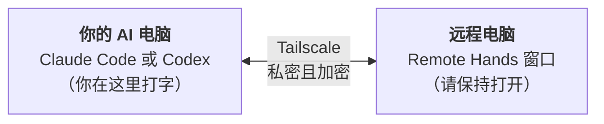

<div align="center">

# Remote Hands

[English](README.md) · **中文** · [Čeština](README.cs.md)

**让一台电脑上的 Claude Code 或 Codex，帮你操作你的另一台电脑——通过 Tailscale，私密又安全。**

[](https://github.com/HamsterPark/remote-hands/actions/workflows/ci.yml)
[](https://github.com/HamsterPark/remote-hands/releases/latest)
[](LICENSE)

</div>

你在一台电脑上使用 AI 助手——**Claude Code** 或 **Codex**。有了 Remote Hands，这个助手还能去操作你的**另一台**电脑：查看文件、安装程序、修改设置、给屏幕截图，就像它坐在那台电脑前面一样。你只需要复制一次**两行文字**。



> **赶时间，而且很懂电脑？** 在两台电脑上用同一个账号安装 [Tailscale](https://tailscale.com/download)。然后在远程电脑上运行 `$env:REMOTE_HANDS_LANG='zh'; irm https://raw.githubusercontent.com/HamsterPark/remote-hands/main/install.ps1 | iex`（Windows PowerShell）或 `curl -fsSL https://raw.githubusercontent.com/HamsterPark/remote-hands/main/install.sh | REMOTE_HANDS_LANG=zh sh`（macOS、Linux），把打印出来的两行文字粘贴到另一台电脑上的 Claude Code 或 Codex 里，再重启 AI。详细说明见[技术说明](docs/TECHNICAL.md)（英文）。

## 目录

1. [开始之前](#开始之前)
2. [第 1 步 在两台电脑上安装 Tailscale](#第-1-步-在两台电脑上安装-tailscale)
3. [第 2 步 用同一个账号登录 Tailscale](#第-2-步-用同一个账号登录-tailscale)
4. [第 3 步 在远程电脑上启动 Remote Hands](#第-3-步-在远程电脑上启动-remote-hands)
5. [第 4 步 把两行文字发到 AI 电脑上](#第-4-步-把两行文字发到-ai-电脑上)
6. [第 5 步 把两行文字交给 Claude Code 或 Codex](#第-5-步-把两行文字交给-claude-code-或-codex)
7. [日常使用](#日常使用)
8. [安全须知 请务必阅读](#安全须知-请务必阅读)
9. [遇到问题怎么办](#遇到问题怎么办)

## 开始之前

这份说明里有两个词，先认识一下：

* **AI 电脑**——你平时使用 Claude Code 或 Codex 的那台电脑。你在这台电脑上告诉 AI 要做什么。
* **远程电脑**——要让 AI 去操作的那台电脑。Remote Hands 就运行在这台电脑上。

你需要准备：

* 两台电脑，系统是 **Windows 10 或 11**、**macOS 13 或更新版本**，或者 **Linux**，并且都能上网。两台电脑可以在不同的房子里，甚至在不同的国家。
* AI 电脑上已经能正常使用 **Claude Code**（[安装方法](https://code.claude.com/docs/en/overview)）或 **Codex**（[安装方法](https://developers.openai.com/codex)）。
* 一个 **Google、Microsoft、Apple 或 GitHub 账号**，用来登录 Tailscale。个人使用 Tailscale 是免费的。（在中国大陆，Google 账号用不了，请准备 Microsoft 或 Apple 账号，详见第 2 步。）
* 大约 **15 分钟**的时间。

> [!TIP]
> 请按顺序一步一步来。每一步都会告诉你，要在**哪一台**电脑上操作。
>
> Tailscale 只有英文界面，所以它的按钮和菜单会用**粗体英文**写出来，后面的括号里是中文意思。Windows 和 Mac 上的界面文字用「」标出来；如果你的系统是英文的，括号里有英文对照。

## 第 1 步 在两台电脑上安装 Tailscale

[Tailscale](https://tailscale.com) 是一个免费的应用，可以把你自己的几台电脑连成一个小小的私人网络，不管它们在哪里。Remote Hands 只通过这个私人网络通信，所以互联网上的其他人根本连不到它。

**这一步，远程电脑和 AI 电脑都要做。** 如果已经装过 Tailscale，直接跳到第 2 步。

### Windows

1. 在浏览器里打开 <https://tailscale.com/download/windows>。
2. 点击 **Download Tailscale for Windows**（下载 Windows 版 Tailscale）。
3. 下载完成后，打开下载好的文件。它的名字类似 `tailscale-setup-….exe`，在你的「下载」（Downloads）文件夹里。
4. Windows 会问你：「你要允许此应用对你的设备进行更改吗？」（*Do you want to allow this app to make changes to your device?*）请点「是」（**Yes**）。
5. 按照安装程序的提示一直做到最后（如果要求同意许可协议，就同意；然后点 **Install**（安装））。
6. 现在，Tailscale 会以一个小图标的形式，出现在**屏幕右下角、时钟旁边**。如果没看到，点一下那里的小箭头 **^**——它可能藏在那个小框里。

### Mac

> [!IMPORTANT]
> **Mac 请注意：** 请从 Tailscale 官网下载，不要去 App Store 里找。在中国大陆区的 App Store 里，根本没有 Tailscale。

1. 在浏览器里打开 <https://tailscale.com/download/mac>。
2. 点击 **Download Tailscale for macOS**（下载 macOS 版 Tailscale）。请用这个下载，不要用 App Store。
3. 打开下载好的文件（`Tailscale-….pkg`，在「下载」文件夹里），依次点击「继续」（**Continue**）和「安装」（**Install**）。如果系统让你输入密码，就输入你的 Mac 登录密码。
4. 在「应用程序」（Applications）文件夹里打开 **Tailscale**。
5. Mac 会弹出一个提示，说有一个系统扩展被阻止了（英文系统里的标题是 *System Extension Blocked*）。点这个提示里的「打开系统设置」（**Open System Settings**），然后：
   * **macOS 15 或更新版本：** 进入「通用」→「登录项与扩展」（**General → Login Items & Extensions**），点一下「网络扩展」（**Network Extensions**）旁边的 **ⓘ** 按钮，打开 **Tailscale Network Extension** 的开关，输入密码，再点「完成」（**Done**）。
   * **macOS 13 或 14：** 进入「隐私与安全性」（**Privacy & Security**），向下滚动，找到一条关于 Tailscale.app 的提示，意思是它的系统软件「已被阻止载入」（英文是 *System software from application Tailscale.app was blocked from loading*），然后点「允许」（**Allow**）。
6. 如果 Mac 询问是否要添加 VPN 配置，点「允许」（**Allow**）。
7. 现在，Tailscale 会以一个小图标的形式，出现在**屏幕右上角的菜单栏**里。

### Linux

打开终端（常用的快捷键是 <kbd>Ctrl</kbd>+<kbd>Alt</kbd>+<kbd>T</kbd>），然后运行：

```sh
curl -fsSL https://tailscale.com/install.sh | sh
sudo tailscale up
```

第二条命令会打印出一个网址。打开这个网址，然后从第 2 步的第 2 点继续。

## 第 2 步 用同一个账号登录 Tailscale

**这一步，两台电脑都要做。**

1. 点击 **Tailscale 图标**（Windows：右下角时钟旁边；Mac：右上角的菜单栏里），然后选择 **Log in…**（登录）。第一次使用时，可能会先出现一个欢迎窗口，里面是 **Get Started**（开始使用）按钮——点它就行。
2. 浏览器会打开一个 Tailscale 网页。请选一种登录方式：**Sign in with Google**（用谷歌账号登录）、**Sign in with Microsoft**（用微软账号登录）、**Sign in with GitHub**（用 GitHub 账号登录）或 **Sign in with Apple**（用苹果账号登录），然后像平时一样登录。

   **在中国大陆：** 不能用 Google 登录，请选 Microsoft 或 Apple（GitHub 有时也行）。如果 Tailscale 的登录网页打不开，或者一直在转圈，第一次登录可能需要开 VPN 或代理。
3. 第一次登录时，Tailscale 可能会问你几个问题。比如它会问你是 **Personal use**（个人使用）还是 **Business use**（商业使用），请选 **Personal use**。它还可能要你 **Connect**（连接）这台设备，点 **Connect** 就行。

> [!IMPORTANT]
> **两台电脑必须用完全相同的账号登录**（同一种登录方式、同一个邮箱）。如果用了两个不同的账号，就会变成两个互相独立的私人网络，两台电脑就看不到对方了。

**检查一下有没有成功：** 再点一下 Tailscale 图标。你应该能看到这台电脑的名字，和一串以 **100.** 开头的数字；在 **Network devices**（网络设备）下面，还能看到另一台电脑。你也可以打开 <https://login.tailscale.com/admin/machines>：两台电脑都应该出现在那个列表里。

> [!TIP]
> 登录 180 天后，Tailscale 会要求每台电脑重新登录一次。为了让远程电脑没有人看着也能一直用，请打开上面链接里的设备列表，点远程电脑旁边的 **…**，选择 **Disable key expiry**（关闭密钥过期）。

## 第 3 步 在远程电脑上启动 Remote Hands

**这一步在远程电脑上做。**

### Windows

1. 点击「开始」按钮（Windows 图标），输入 **PowerShell**，然后按 <kbd>Enter</kbd>。会打开一个可以输入文字的窗口。注意：**不要**选「以管理员身份运行」（*Run as administrator*），不需要。
2. 复制下面这一行（在 GitHub 上，把鼠标移到框上，框的右端会出现一个复制按钮）：

   ```powershell
   $env:REMOTE_HANDS_LANG='zh'; irm https://raw.githubusercontent.com/HamsterPark/remote-hands/main/install.ps1 | iex
   ```

3. 点一下 PowerShell 窗口，按 <kbd>Ctrl</kbd>+<kbd>V</kbd> 粘贴（也可以点鼠标右键），然后按 <kbd>Enter</kbd>。
4. 几秒钟后，Remote Hands 的窗口就出现了（样子见下面的示例）。
5. Windows 可能会询问防火墙的事。要允许，AI 电脑才能连上来：
   * 如果弹出「Windows 安全中心警报」，里面写着「Windows Defender 防火墙已经阻止此应用的部分功能」（英文系统里是 *Windows Security Alert* 和 *Windows Defender Firewall has blocked some features of this app*），请确认「专用网络」（**Private networks**）前面的方框是打了勾的，然后点「允许访问」（**Allow access**）。
   * 较新的 Windows 11 会问「是否允许专用网络访问此应用?」（*Do you want to allow private networks to access this app?*），请点「允许」（**Allow**）。

### Mac

1. 按 <kbd>⌘ Command</kbd>+<kbd>Space</kbd>（空格键），输入「终端」（英文系统输入 **Terminal**），然后按 <kbd>Enter</kbd>。
2. 复制下面这一行，按 <kbd>⌘ Command</kbd>+<kbd>V</kbd> 粘贴到「终端」窗口里，然后按 <kbd>Enter</kbd>：

   ```sh
   curl -fsSL https://raw.githubusercontent.com/HamsterPark/remote-hands/main/install.sh | REMOTE_HANDS_LANG=zh sh
   ```

3. 如果 Mac 询问「终端」能不能访问「桌面」（Desktop）文件夹里的文件，请点「好」（**OK**）。Remote Hands 会把启动图标放在桌面上。

### Linux

打开终端，运行和 Mac 上一样的那一行命令。

### 你会看到什么

```text
==================================================================
  Remote Hands 0.1.0
  让你另一台电脑上的 Claude Code 或 Codex 通过你自己的 Tailscale 私人网络
  来控制【这台】电脑。
==================================================================

[OK] Tailscale 已连接。这台电脑的名字是 office-pc（100.86.1.2）。
[OK] 正在 100.86.1.2:47863 等待你的 AI 连接（只能通过 Tailscale 访问）。

请复制下面这两行，粘贴到你【另一台电脑】上的 Claude Code 或 Codex 里：
==================================================================
Remote Hands: please connect to my computer office-pc. It is an MCP server (streamable HTTP; the key is inside the URL, no other login): http://100.86.1.2:47863/mcp/0f3c9a2b7d4e8f1a6b5c3d2e9f0a1b7c
How: Claude Code -> claude mcp add -s user -t http office-pc <URL> (if office-pc already exists, first: claude mcp remove -s user office-pc) ; Codex -> codex mcp add office-pc --url <URL> ; then tell me to restart you, and use the office-pc tools (start with system_info).
==================================================================
（这两行已经复制到这台电脑的剪贴板里了。要把它们传到另一台电脑，可以发邮件给自己，或者用微信“文件传输助手”等聊天工具发给自己。）

 * 请让这个窗口保持打开。关掉这个窗口，远程控制就停止了。
 * 这个窗口开着的时候，这台电脑不会自动睡眠。
 * 任何拿到这两行、并且在你的 Tailscale 网络里的人，都能完全使用这台电脑。不要把它们给别人。
 * 想让旧的两行失效：输入  new  然后按回车。

AI 在这台电脑上做了什么：
14:02:11  my-laptop  已连接（claude-code 2.1.310）
14:02:15  my-laptop  查看了系统信息
14:02:20  my-laptop  执行了命令：Get-PSDrive C
```

你的电脑名字、地址和密钥，会和这里的示例不一样。

窗口里的文字平时会使用你电脑的语言（英文、中文或捷克文）。上面的安装命令里已经加上了 `REMOTE_HANDS_LANG=zh`（Windows 那一行是 `$env:REMOTE_HANDS_LANG='zh';`），所以就算你的电脑是英文系统，窗口也会显示中文。想换成别的语言，把 `zh` 改成 `en`（英文）或 `cs`（捷克文）就行。

> [!NOTE]
> **下次**就不用再输入那一行命令了：双击桌面上的 **Remote Hands** 就行（在 Windows 上，「开始」菜单里也有）。两行文字保持不变，所以 AI 电脑不用重新设置。

## 第 4 步 把两行文字发到 AI 电脑上

这两行文字已经复制好了（在远程电脑上）。现在要把它们送到 AI 电脑上。请把它们粘贴（<kbd>Ctrl</kbd>+<kbd>V</kbd>，在 Mac 上是 <kbd>⌘</kbd>+<kbd>V</kbd>）到一个你在 AI 电脑上也能打开的地方，比如：

* 微信：发给「文件传输助手」
* QQ：发给「我的电脑」
* 一封**发给自己的电子邮件**
* 其他能**给自己发消息**的聊天软件：WhatsApp（*Message yourself*）、Telegram（*Saved Messages*）、Signal（*Note to Self*）等
* 如果两台都是苹果设备，并且登录了同一个 Apple 账户：直接在另一台 Mac 上粘贴就行（「通用剪贴板」，英文是 *Universal Clipboard*）

在 AI 电脑上，打开那条消息，把两行文字复制出来。

> [!WARNING]
> 这两行文字就是进入远程电脑的钥匙。只能发给你自己。

## 第 5 步 把两行文字交给 Claude Code 或 Codex

**这一步在 AI 电脑上做。**

1. 像平时一样启动 Claude Code 或 Codex。
2. 把两行文字粘贴到它的聊天框里，然后按 <kbd>Enter</kbd>。
3. AI 想运行一条用来保存连接的命令（命令以 `claude mcp add` 或 `codex mcp add` 开头）。它会征求你的同意——请选 **Yes**（是）。
4. **重启 AI**，让它加载新的连接：
   * **Claude Code：** 输入 `/exit` 并按 <kbd>Enter</kbd>，然后输入 `claude --continue` 并按 <kbd>Enter</kbd>（这样还能接上刚才的对话）。
   * **Codex：** 输入 `/exit` 并按 <kbd>Enter</kbd>，然后输入 `codex resume --last` 并按 <kbd>Enter</kbd>。
   * 如果你用的是应用程序（Claude 桌面版、VS Code、Codex 应用）：把它完全关掉，再重新打开。
5. 试一试：输入“用 office-pc 的 system_info 工具看看，那是一台什么样的电脑？”（把 `office-pc` 换成你那两行文字里的电脑名字）。
6. AI 第一次使用 Remote Hands 的工具时，会征求你的同意。先看清它想做什么，再同意。

完成了！在远程电脑上的 Remote Hands 窗口里，你可以看到 AI 做的每一件事。

> [!NOTE]
> Tailscale 在中国大陆境内没有中继服务器，所以两台电脑没法直接互相连上时，数据要绕远路，速度可能会慢一些。AI 发送的主要是文字命令，一般不受影响。

## 日常使用

直接告诉 AI 你想做什么，并说出是哪台电脑：

* “在 office-pc 上，硬盘还剩多少可用空间？”
* “给 office-pc 的屏幕截个图，告诉我错误提示上写了什么。”
* “在 office-pc 上安装 VLC，并在桌面上放一个快捷方式。”
* “在 office-pc 上找出去年夏天的照片，复制到桌面上的一个新文件夹里。”
* “在 grandma-laptop 上看看有没有等待安装的 Windows 更新。”

**有多台电脑时：**

* **多台远程电脑，一台 AI 电脑：** 在每台远程电脑上都运行 Remote Hands，再把每台电脑各自的两行文字交给 AI。每台电脑都有自己的名字，告诉 AI 用哪一台就行。
* **一台远程电脑，多台 AI 电脑：** 在每台 AI 电脑的 Claude Code 或 Codex 里，粘贴同样的两行文字。

**停止和重新启动：**

* **停止：** 关掉 Remote Hands 窗口。从这一刻起，AI 就不能在那台电脑上做任何事了。
* **重新启动：** 双击桌面上的 **Remote Hands**。两行文字不变，什么都不用重新设置。
* 窗口开着的时候，远程电脑不会进入睡眠。（笔记本电脑合上盖子，还是会睡眠。）
* **更新：** 把第 3 步里的那一行命令再运行一次。

## 安全须知 请务必阅读

* Remote Hands 让 AI 对远程电脑拥有**和你坐在电脑前时一样的控制权**：它可以读取、修改和删除你的文件，也可以安装程序。
* 只有**你自己**的 Tailscale 网络里的电脑才能连上它，而且必须有那两行文字里的密钥。没有任何东西对互联网开放，Tailscale 也会把所有内容加密。
* **请保管好这两行文字，不要给别人。** 如果别人可能拿到了它们，请在 Remote Hands 窗口里输入 `new` 并按 <kbd>Enter</kbd>：旧的两行会立刻失效。然后把新的两行交给你的 AI。
* Claude Code 和 Codex 在使用工具之前都会先问你。同意之前，请**看清它们想做什么**。
* AI 自己不会得到管理员权限。如果某件事需要管理员权限，远程电脑的屏幕上会弹出一个问题，必须有人在那台电脑前回答才行。
* 不用的时候，请把窗口关掉。

## 遇到问题怎么办

<details>
<summary><b>窗口里说它在等待 Tailscale</b></summary>

这台电脑上的 Tailscale 没有安装、没有运行，或者还没有登录。请打开 Tailscale 并登录（第 1、2 步）。窗口会自动继续，不用管它。
</details>

<details>
<summary><b>AI 说连不上（超时、连接被拒绝、失败）</b></summary>

请一项一项检查：

1. 远程电脑上的 **Remote Hands 窗口还开着吗**？
2. 远程电脑**醒着吗**？（没有睡眠，笔记本的盖子是打开的。）
3. 两台电脑上的 Tailscale **都已连接，而且用的是同一个账号吗**？分别点一下两台电脑上的 Tailscale 图标看看。
4. **Windows 防火墙：** 如果 Windows 询问防火墙时你点了「取消」（*Cancel*），Windows 现在就会拦住 Remote Hands。请这样处理：点「开始」，输入「高级安全 Windows Defender 防火墙」（*Windows Defender Firewall with Advanced Security*），或者直接输入 `wf.msc`，然后打开它。点「入站规则」（**Inbound Rules**），找到名为 **remote-hands.exe**、带红色禁止标志的规则，把它们删掉（点鼠标右键，选「删除」，英文是 **Delete**）。最后重新启动 Remote Hands，这一次点「允许访问」（**Allow access**）。
5. 让 AI 运行 `curl http://<the 100.x.y.z address>:47863/health`（`<the 100.x.y.z address>` 要换成你那两行文字里、以 100. 开头的地址）。如果它回答 `remote-hands ok`，说明连接是通的，问题出在 AI 的设置上：请让它用 `claude mcp list` 或 `codex mcp list` 检查一下。
</details>

<details>
<summary><b>AI 说“wrong key”（密钥不对）或者“404 / not found”</b></summary>

有人在 Remote Hands 窗口里输入了 `new`，所以旧的两行已经失效了。请从窗口里复制新的两行，再交给 AI（第 4、5 步）——AI 会用新的连接替换掉旧的。
</details>

<details>
<summary><b>我把那两行文字弄丢了</b></summary>

看看 Remote Hands 窗口就行，或者重新启动 Remote Hands——它显示的永远是当前有效的两行（只有在有人输入 `new` 之后，这两行才会变）。
</details>

<details>
<summary><b>Windows 提示「Windows 已保护你的电脑」，或者杀毒软件报警</b></summary>

出现这种情况，是因为 Remote Hands 是一个新程序，而且它允许远程控制。它是开源的，安装程序也会检查下载的文件是不是和公开发布的文件完全一样。如果你信任它，请点「更多信息」（**More info**）→「仍要运行」（**Run anyway**），或者在杀毒软件里允许它。
</details>

<details>
<summary><b>Mac：截图里只有桌面背景</b></summary>

打开「系统设置」→「隐私与安全性」→「录屏与系统录音」，把「终端」的开关打开（英文系统：**System Settings → Privacy & Security → Screen & System Audio Recording**，打开 **Terminal**）。在 macOS 13 里，最后一项叫「屏幕录制」（**Screen Recording**）。接着关掉 Remote Hands，再重新启动。
</details>

<details>
<summary><b>从 GitHub 下载不成功（比如在中国大陆）</b></summary>

GitHub 在中国大陆经常很慢，有时还会连不上。请过一会儿再试，或者开 VPN 再试。在 Windows 上，你也可以自己到[发布页面](https://github.com/HamsterPark/remote-hands/releases/latest)手动下载程序 `remote-hands-windows-amd64.exe`（少数使用 ARM 处理器的 Windows 电脑请下载 `remote-hands-windows-arm64.exe`），然后双击运行。在 Mac 或 Linux 上，最简单的还是用「终端」里的那一行命令；如果 GitHub 连不上，就开着 VPN 运行它。
</details>

<details>
<summary><b>怎么卸载 Remote Hands？</b></summary>

* **Windows：** 删除 **Remote Hands** 快捷方式，以及文件夹 `%LOCALAPPDATA%\Programs\RemoteHands` 和 `%APPDATA%\remote-hands`。要打开它们，把这两个路径粘贴到「文件资源管理器」（*File Explorer*）的地址栏里。
* **Mac：** 删除桌面上的 `Remote Hands.command`，然后在「终端」里运行 `rm -rf ~/.local/bin/remote-hands ~/Library/Application\ Support/remote-hands`。
* **Linux：** `rm -rf ~/.local/bin/remote-hands ~/.config/remote-hands`
* **在 AI 电脑上：** 让 AI 删除这个连接，或者自己运行 `claude mcp remove -s user office-pc` 或 `codex mcp remove office-pc`。
</details>

## 给技术人员

工作原理、AI 能用的工具、安全模型、各种选项，以及如何从源码构建，都在这里：**[docs/TECHNICAL.md](docs/TECHNICAL.md)**（英文）。

Remote Hands 是一个小巧的 Go 程序，不依赖任何其他库。它只在这台电脑的 Tailscale 地址上提供 [Model Context Protocol](https://modelcontextprotocol.io)（模型上下文协议）服务。欢迎参与贡献。许可证：[MIT](LICENSE)。

*Remote Hands 是一个独立项目，与 Tailscale、Anthropic 和 OpenAI 没有任何关联。*
